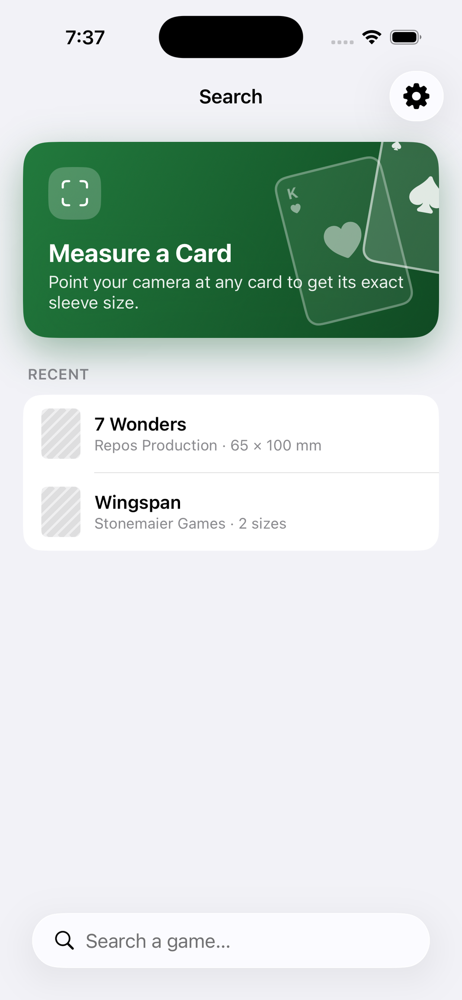
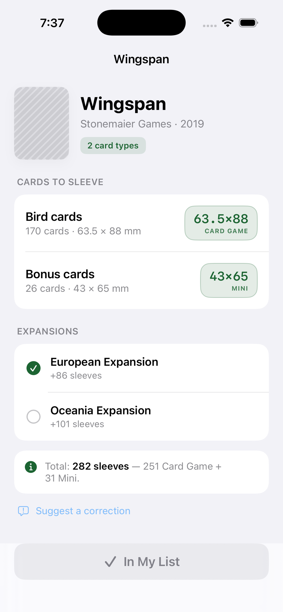
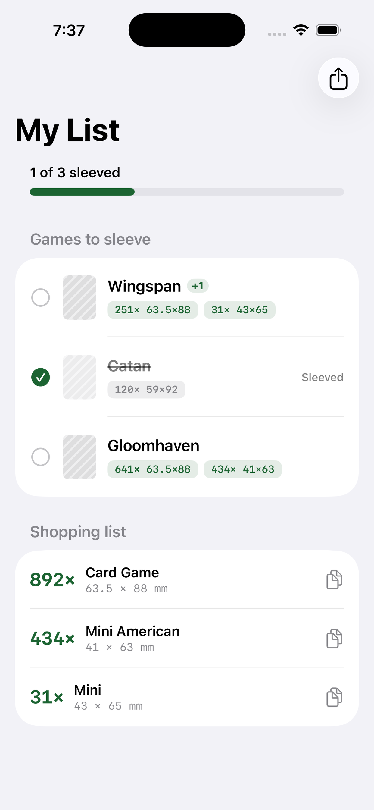
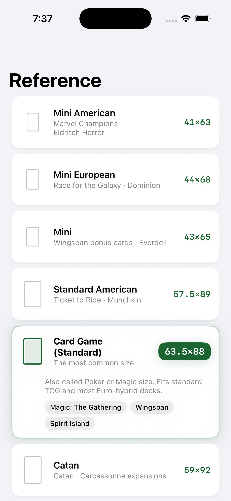
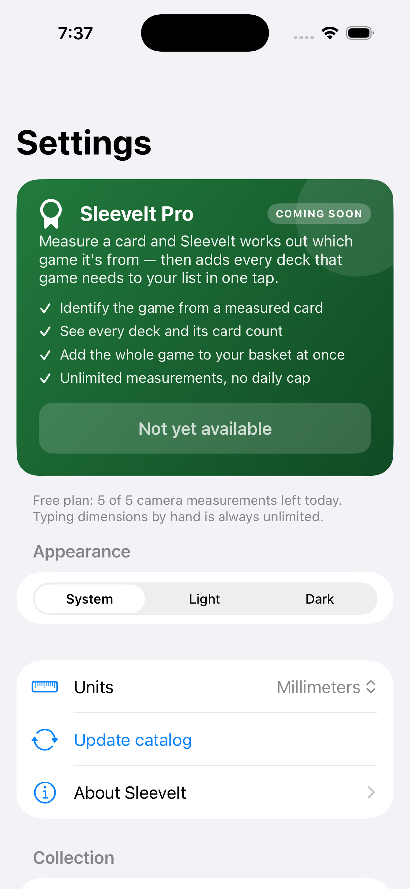

<div align="center">

# SleeveIt

### Measure a card, get the right sleeve — sleeve it, don't leave it.

A native iOS app that finds the exact sleeve size for your board game cards. Point your camera
at a card and ARKit measures it in real millimetres, look a game up in the catalog, and SleeveIt
builds a consolidated shopping list of every sleeve you need to buy.

SwiftUI · SwiftData · ARKit · Vision · WidgetKit · App Intents · iOS 17+ · iPhone

</div>

## Screenshots

| Search | Measure result | My List |
|:---:|:---:|:---:|
|  |  |  |

| Reference | Settings |
|:---:|:---:|
|  |  |

<sub>Full-resolution App Store assets (6.5″, 1242 × 2688 px) live in [`Marketing/`](Marketing).</sub>

## What it does

- **Measure a card** with the camera — ARKit projects the card's corners onto the surface it
  rests on for a true-millimetre size, then recommends the matching sleeve. A reference-photo mode
  covers devices without AR.
- **Search a catalog** of games and see every deck's card count and size, expansions included.
- **My List** consolidates every game (and measured card) into one shopping list — "buy 892
  Standard, 434 Mini American" — with sleeved-progress tracking and share/export.
- **Import your BoardGameGeek collection** (read-only) to seed the list.
- **Reference** cheat-sheet of every standard sleeve size, drawn to scale.
- **Widget + Shortcuts** for "sleeves to buy" at a glance and a "Measure a card" Siri action.

## Build & run

1. Open `SleeveIt.xcodeproj` in Xcode 26+ and run on the simulator — no setup needed.
2. **For a device build**, set your own Signing Team on the `SleeveIt` and `SleeveItWidgetExtension`
   targets (the committed project ships with an empty `DEVELOPMENT_TEAM` on purpose).
3. **Optional integrations** are off until you configure them, and the app degrades gracefully
   without them:
   - **BoardGameGeek import** needs a registered API token — add `Support/BGGToken.plist` with a
     `token` string key (git-ignored; see [`BGGConfiguration`](SleeveIt/BGG/BGGConfiguration.swift)).
   - **Catalog updates** and **corrections** point at placeholder endpoints you host yourself.
   - **App Group / iCloud** capabilities must be enabled in your developer account for device builds.

Nothing secret is committed: no API tokens, no signing team, no provisioning profiles (see
`.gitignore`).

## Architecture

```
SleeveIt/
  SleeveItApp.swift        ModelContainer + catalog bootstrap
  Models/                  SwiftData @Model types + sleeve math + title matching
  Catalog/                 Bundled seed + remote sync
  Measure/                 ARKit engine, reference-photo fallback, quota, entitlements
  BGG/                     BoardGameGeek collection import
  Corrections/             User-submitted catalog fixes
  Features/                The screens
  Design/                  Theme + shared components
  Assets.xcassets/         App icon + accent colour
SleeveItTests/             Measurement math, catalog integrity, expansion + reference geometry
Marketing/                 Source art (not compiled into the app)
```

The app icon is derived from `Marketing/SleeveIt icon.png`. That source is a pre-rounded tile with a grey stroke and a drop shadow sitting on a white page. iOS requires **full-bleed, opaque, square** art and applies its own squircle mask, so the shipped `AppIcon-1024.png` crops inside the stroke and extends the tile's gradient into the corner voids — keeping the original's gradient and card shadow while giving iOS a clean square to mask.

`Marketing/SleeveIt icon - rounded preview.png` shows the masked result. It is a reference image only and is not compiled into the app. If you replace the source art, redo this step rather than dropping the raw file into the asset catalogue.

**Catalog data is server-owned, user data is device-owned.** `ListEntry` and `RecentLookup` reference catalog rows by string id rather than by SwiftData relationship, so a catalog refresh replaces games wholesale without ever orphaning or deleting something the user created.

## How measuring works

Vision finds the card's quadrilateral in the camera frame; ARKit raycasts those four corners onto the detected table plane. Vision alone gives pixels, ARKit alone measures wherever the user aimed — together they measure the card actually on the table, in real millimetres.

Per-frame geometry is noisy, so `MeasurementStabilizer` holds a rolling window and only reports a lock once the spread across it is under 0.8mm, taking the median so one bad raycast can't skew the result. Opposite edges are averaged to cancel perspective skew, and quads whose opposite edges disagree by more than 4mm are discarded as mis-detections.

Works on any ARKit device; LiDAR improves plane depth but isn't required. **Requires a physical device** — the simulator has no camera, so it falls through to the manual-entry path.

## Catalog updates

The bundled `Catalog/catalog.json` seeds the store on first launch. `CatalogStore.refresh()` then fetches a newer version from `CatalogStore.remoteURL` — **change that constant to a host you control** (S3, R2, GitHub Pages; any static file works).

Serve the same JSON shape with an incremented `version`. The client sends `If-None-Match`, so an unchanged catalog costs a 304 with no body. A payload is only applied when its `version` is greater than the installed one, so a bad deploy is rolled back by publishing a higher version with corrected data. Every failure path is non-fatal: the last good catalog stays in place and the app remains fully usable offline.

### Catalog data accuracy

The seed ships 40 games and 9 sleeve standards. **Card counts need verifying before you ship.** They were compiled from general knowledge of these games, not transcribed from a authoritative source, and counts legitimately vary between printings, editions and localisations — a second-edition box often differs from the first. Treat the numbers as a strong starting point, not ground truth. The app already tells users sizes vary by printing, but a wrong count means someone buys the wrong number of sleeves.

Cross-checking against the [Card Size Database geeklist](https://boardgamegeek.com/geeklist/48357/card-size-database) is the fastest way to firm them up.

## BoardGameGeek import

Settings → Collection → BoardGameGeek imports the games a user marks as **owned** on BGG.

**One-way and read-only.** The client only issues GETs. SleeveIt never writes to a BGG account, and the only data leaving the device is the username being looked up. Nothing about the user's SleeveIt list is transmitted.

Imported titles are matched to the catalog by normalised title (`GameTitleMatcher`), with per-game `aliases` in the catalog covering known variants like "Settlers of Catan". Matching on title rather than BGG's numeric id is deliberate: a missing id degrades to "not found", whereas a *wrong* id silently links a game to the wrong card counts. Games not in the catalog are listed but cannot be imported — without card dimensions there is no sleeve count to give.

### Setup required

**Since late October 2025 the BGG XML API rejects anonymous requests with a 401 on every endpoint.** Using it now requires registering an application and sending a bearer token. Until you do:

1. Register at <https://boardgamegeek.com/using_the_xml_api>.
2. Create `SleeveIt/BGG/BGGToken.plist` with a single `token` string key.
3. Keep that file out of source control.

Without a token, `BGGConfiguration.isConfigured` is false and the import screen shows a setup message rather than failing at request time.

Note that a token shipped in an app binary is extractable — that is inherent to BGG's model for client apps. Treat it as an identifier rather than a secret, and be ready to rotate it.

Commercial use of the API needs a separate licence from BGG. **SleeveIt qualifies as non-commercial only while it stays free** — if you add paid features later, revisit this before shipping.

### Why the catalog isn't sourced from BGG

**The BGG API carries no card-dimension data.** It can tell you a user owns Wingspan; it cannot tell you Wingspan needs 170 standard and 26 mini sleeves. Card sizes live only in human-curated community resources like the [Card Size Database geeklist](https://boardgamegeek.com/geeklist/48357/card-size-database) and the [Card Sleeve Reference wiki](https://boardgamegeek.com/wiki/page/Card_Sleeve_Reference).

So the two systems do different jobs: BGG says *which games the user owns*, the local catalog says *what sleeves those games need*. That is also why a BGG outage or a revoked token degrades the import but never breaks the app.

## Before shipping

- **Point `remoteURL` at your host.** It's a placeholder domain that doesn't resolve.
- **Test on device.** The AR path cannot run in the simulator. Tune `MeasurementStabilizer.toleranceMM` and the Vision `minimumConfidence` against real cards in real lighting — those constants are reasoned defaults, not empirically fitted ones.

## Progress tracking, expansions, corrections, reference measuring

Four "core depth" features, all catalog- or geometry-driven (no backend needed to run, except
corrections — see below).

**Sleeved progress.** My List shows an "X of Y sleeved" header and bar. The per-row toggle (the
`ListEntry.isOwned` field, surfaced as "Sleeved") both marks completion and drops the game from
the shopping list. The field name stays `isOwned` in the store — renaming a `@Model` property is
a migration for no benefit; only the user-facing copy changed.

**Expansions.** `Game.baseGameID` links an expansion to its base. A base game's detail screen
lists its expansions with toggles; ticking one folds its decks into the sleeve total, and the
choice persists on `ListEntry.includedExpansionIDs` so the shopping list reflects it. All
combination math goes through one pure function, `SleeveMath.combinedCounts(base:expansions:)`,
used by both the detail preview and the shopping list — unit-tested, so the two can't drift.
Catalog is bumped to **v3** with real expansions (Wingspan European/Oceania, etc.); the
delete-then-insert re-seed handles v2→v3 cleanly.

**Catalog corrections.** "Suggest a correction" (game detail) and "Add this game" (search
no-results) open a form that submits a `CorrectionReport`. **The app side is complete; the
backend is not — it can't be, from inside an app.** `CorrectionService.isConfigured` is `false`
until you point `CorrectionService.endpoint` at a handler you run and flip the flag. Until then
the form falls back to composing an email, so no report is lost.

The backend contract you'd stand up: a `POST /corrections` endpoint receiving one
`CorrectionReport` as JSON (`kind`, `gameID?`, `gameTitle`, `details`, `submittedAt`,
`appVersion`, `catalogVersion`), a moderation queue, and a path from an approved fix into a
bumped `catalog.json` version — which the existing `CatalogStore.refresh()` ETag/version flow
then pulls to every client. That closes the loop: user reports a wrong count → you approve → next
catalog version corrects it for everyone.

**Reference-object measuring.** A non-AR path for old devices and low light, offered from the
measure error/unsupported states. The user photographs the card beside a known object (a coin, a
credit card, a poker card's long edge), marks the card's four corners and the reference's length,
and `ReferenceMeasurer` derives mm-per-point from the known length. It produces the **same**
`CardMeasurement` as AR, so the identical result sheet and sleeve matching are reused. It assumes
the card and reference are roughly coplanar and the photo is straight-on — no perspective
correction — so it's less accurate than AR but works where AR can't. `PhotosPicker` needs no
Info.plist permission (it runs out of process).

## Sharing, widget, Shortcuts, iCloud sync, artwork recognition

Four more features. Two are fully self-contained; two carry an external dependency you must
provision (noted below).

**Share / export the shopping list.** My List's toolbar share menu exports the consolidated list
as text or a PDF (`ShoppingListExport`, pure text builder + `UIGraphicsPDFRenderer`). Verified;
unit-tested.

**Widget + Shortcuts.** A `SleeveItWidgetExtension` target shows "N sleeves to buy" (small and
medium families). It reads a tiny snapshot the app writes to an **App Group**
(`group.com.ozsoffy.SleeveIt`) on every My List change — not a shared SwiftData store, just a few
numbers, which is far more robust for a widget. App Intents (`MeasureCardIntent`,
`SleevesToBuyIntent`) expose "Measure a card" and "Sleeves to buy" to Siri and Shortcuts. The
widget appex is embedded in the app bundle (verified in `PlugIns/`).

- The App Group capability is real and works in the simulator. On a device/App Store build it
  must be enabled for both targets in the Apple Developer account (it's in the entitlements
  files under `Support/`).

**iCloud sync of My List — deferred to a future version.** SwiftData stays **local-only** in v1
(one `ModelContainer`, all models). iCloud sync of user data (`ListEntry`, `RecentLookup`,
`LearnedCardPrint`) is planned for v2.

When it lands it's a contained change, but not a free one: CloudKit forbids `@Attribute(.unique)`
and requires a default on every stored property, so the three user models change, and the
container splits (catalog stays local — it's re-seeded from the bundle and must not sync; only
user data goes to CloudKit). You'll also provision an `iCloud.com.ozsoffy.SleeveIt` container in
the Apple Developer account and add the `remote-notification` background mode. None of that is in
the codebase today — it's a deliberate v2 decision.

**Artwork-based game recognition — the honest version.** Recognising a card from its face needs a
labelled reference image per card. That corpus doesn't exist and can't be bundled (the card art
is copyrighted), so SleeveIt **learns on device**: in the Pro identify flow, "Teach SleeveIt this
card's art" stores a Vision feature print (`VNGenerateImageFeaturePrintRequest`) keyed to the
game (`LearnedCardPrint`, CloudKit-synced). Recognition ranks a new card's print against
everything taught (`CardArtworkRecognizer` → `GameIdentifying`).

- The pipeline is complete and unit-tested (self-match closer than cross-match, ranking,
  archive round-trip). **Those tests run only on a device** — `VNGenerateImageFeaturePrintRequest`
  needs the Neural Engine, which the simulator lacks ("espresso context" failure), so they
  `XCTSkip` in the sim.
- **It recognises nothing until taught** (or until a reference corpus is shipped). That's the
  real state of the art here without a card-image dataset; the plumbing is ready for one.

## Free vs Pro

| | Free | Pro |
|---|---|---|
| Measure a card's size | 5 per day | unlimited |
| Recommended sleeve | ✓ | ✓ |
| Identify which game the card is from | — | ✓ |
| Full deck breakdown for that game | — | ✓ |
| Add every deck to the basket at once | — | ✓ |
| Search, catalog, My List, Reference, BGG import | ✓ | ✓ |

`Entitlements.isPro` is the single switch — set it from a StoreKit 2 check and every gate opens at once. Settings shows a "Coming soon" card: an announcement, not a purchase flow, so the button is inert rather than leading somewhere that doesn't exist.

Deliberate choices:

- **Only AR locks count against the quota.** Manual entry is unlimited — it is the fallback for when detection fails, and charging a quota unit because the app couldn't see the card would punish the user for the app's shortcoming.
- **Free loses no existing capability.** Everything shipped before this split stays free. Pro only adds.
- **The free tier is told what Pro would do**, in plain text, with no fake blur over a result the app doesn't actually have.

## Game identification — read this before selling it

The Pro flow is: measure a card → identify the game → see every deck → add them all to the basket.

**The identification step narrows; it does not recognise.** `SizeBasedGameIdentifier` returns every catalog game that uses the measured size and asks the user to confirm. That is a real limit: 63.5×88 is used by most of the catalog, so on the commonest size the list is long.

Two things make it useful anyway:

1. **Games the user owns rank first** — from My List and any imported BGG collection. "Which of your 4 games is this?" is a genuinely useful question; "which of 28 catalog games is this?" is not. This is why the BGG import and the Pro feature reinforce each other.
2. **Once confirmed, the payoff is real.** Measuring one Wingspan bird card yields all 196 sleeves, including the 26 mini ones the user would not have thought to count.

**True automatic recognition is not implemented.** It would mean matching the card's *artwork* against a reference image per card — `VNGenerateImageFeaturePrintRequest` can compute the similarity, but it needs a labelled image corpus that doesn't exist. Building that corpus is the actual work; `GameIdentifying` is the seam it plugs into. If the marketing promises "point at a card and SleeveIt knows the game", that corpus has to exist first.

### Wiring up the purchase later

`MeasurementQuota.isUnlimited` is the single switch. Set it from a real StoreKit 2 entitlement check and the cap lifts everywhere; no other code changes.

The counter resets on calendar-day change, checked on every read path so it is correct after the app sits backgrounded across midnight. It is stored in `UserDefaults` and trusts the device clock — someone can bypass the limit by changing their date. That is a deliberate trade: server-side enforcement is not worth it for a free app, but revisit it if the cap ever protects real revenue.

## Colour

The brand green comes from the app icon and lives in `Design/Theme.swift` as two tokens:

- `Theme.accent` — adaptive tint for text, icons and strokes. `#1C6432` in light, `#3DC76A` in dark, because the icon's forest green is nearly invisible on black.
- `Theme.accentFill` — solid surfaces carrying white text (buttons, filled badges). Stays dark in both appearances; the adaptive tint is far too light to hold white text in dark mode.

Use `accent` for something drawn *on* a background, `accentFill` for the background itself. `Theme.good` stays mint so a locked measurement still reads as success rather than blending into the brand colour.

## Tests

```
xcodebuild test -project SleeveIt.xcodeproj -scheme SleeveIt \
  -destination 'platform=iOS Simulator,name=iPhone 17 Pro'
```

Covers the stabilizer's locking behaviour, size matching (including the Catan 59×92 vs Standard 63.5×88 confusion that matters most), unit formatting, and catalog referential integrity — every deck must point at a size that exists.
